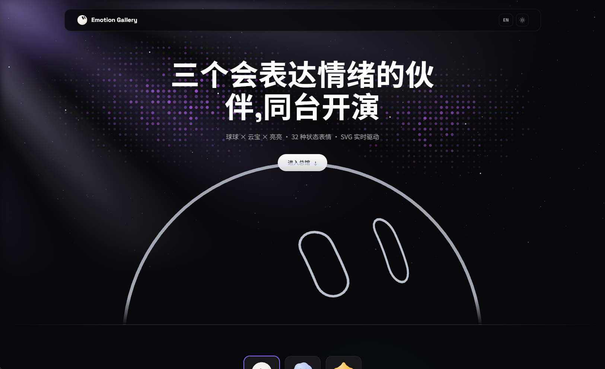
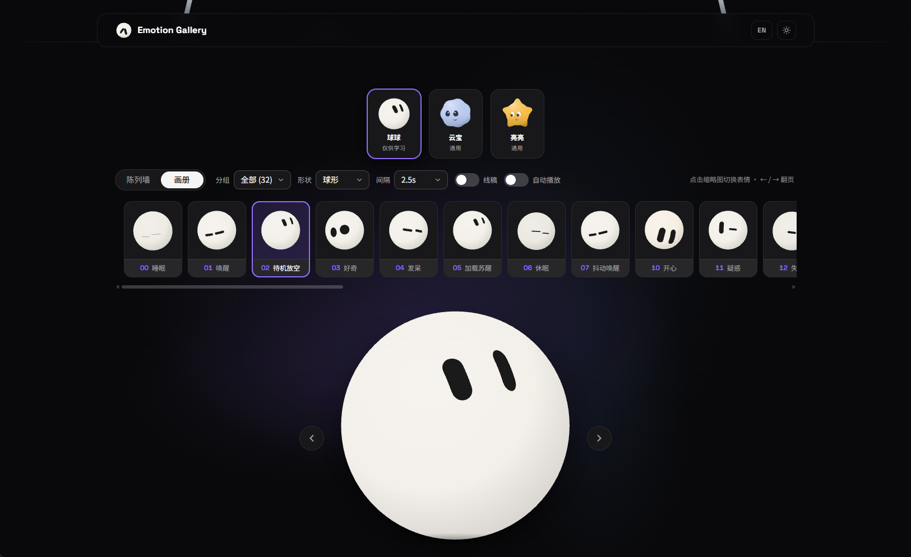
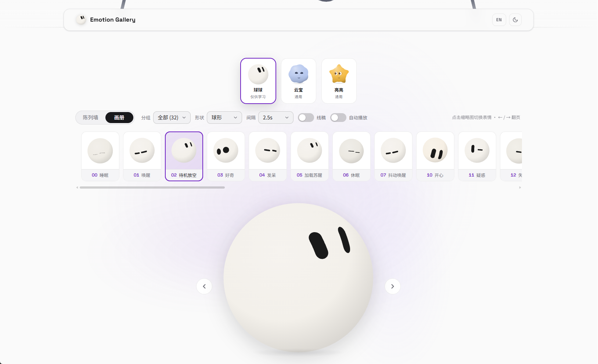
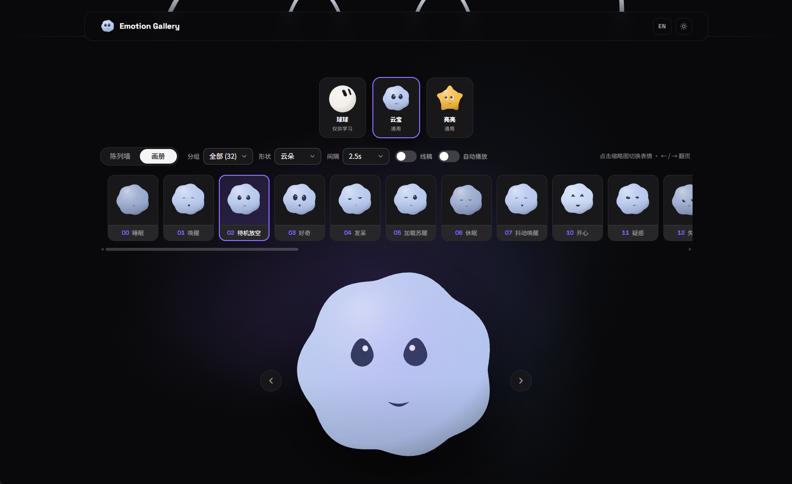
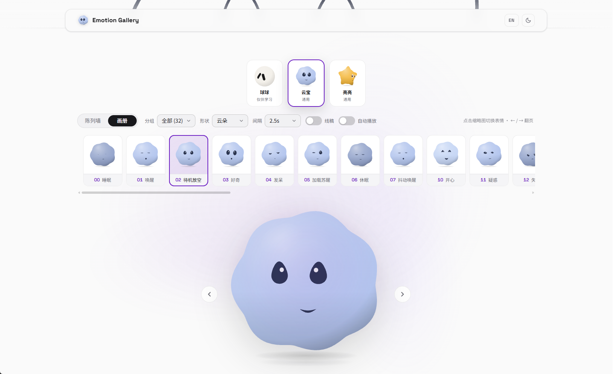
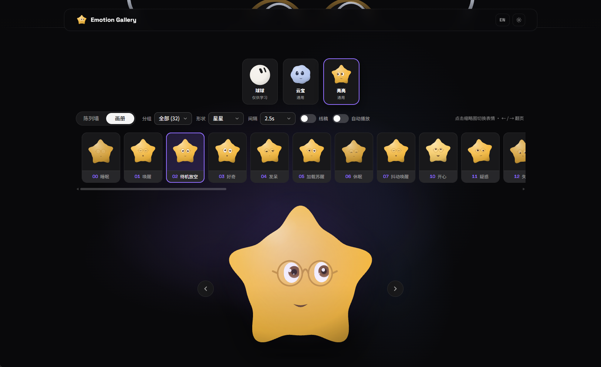
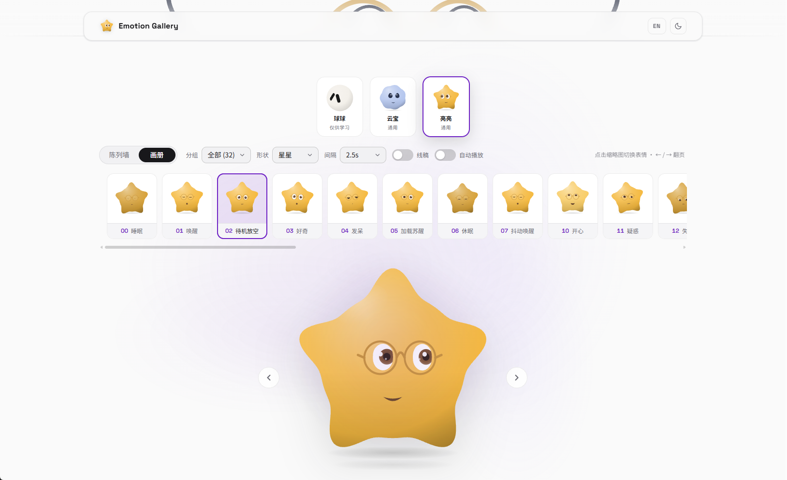

<div align="center">

# Emotion Ball Gallery

**An expression engine for AI assistants — 32 emotion states · 3 body shapes · pure SVG · strict TypeScript · React gallery**

[](https://emotion-balls.vercel.app/)
[](LICENSE)
[](#tech-stack)
[](#tech-stack)

[Live demo](https://emotion-balls.vercel.app/) · [Features](#features) · [Quick start](#quick-start) · [Integration guide](#integration-guide) · [Customization](#customization--extensibility) · [License](#license)

</div>

---

> **License notice**: The **visual designs** of the ball-shaped characters in the [emotion-ball/](emotion-ball/) directory (blob / wedge / gem body silhouettes, color schemes and FX visuals) are for personal technical study and research only — **any commercial use is prohibited** and no commercial license will ever be offered for them. The expression engine source code and emotion configuration data (eye/mouth-shape parameters, animation primitives, keyframe sequences) are independently written and **dual-licensed**: free for non-commercial use, with commercial licensing available. See [LICENSE](LICENSE), [LICENSE-COMMERCIAL.md](LICENSE-COMMERCIAL.md) and [NOTICE.md](NOTICE.md).
>
> The [mood-mates/](mood-mates/) directory is an **original-character sub-project** built on the same engine lineage (Nimbo the cloud / Twinkle the star). Those characters are independently created original designs under a **dual license** (free for personal learning + commercial licensing available) and are not subject to the restriction above.

This repository is "one main gallery + two sub-projects":

- **Main gallery (`/`)**: Nimbo × Twinkle × Ball share **one stage** — the same 32-emotion wall, switchable via the cast cards on top, driven by the two engines (Mood Mates + Emotion Ball) side by side;
- **Mood Mates (`/mood-mates/`)**: the original-character project (Nimbo / Twinkle) — multi-character architecture, dual-licensed and commercially licensable, with its own gallery site and docs;
- **Emotion Ball (`/emotion-ball/`)**: the ball-character project (visuals learning-only; engine & emotion data commercially licensable) — 32 emotion states, 3 body shapes, with its own gallery site.

Emotion Ball is an expression engine for AI assistants: 32 emotion states rendered entirely in pure SVG — no image assets. Your AI only needs to output a single `emotionId` and the ball switches to the matching expression, making it a drop-in emotion layer for chatbots, desktop pets and floating assistants.

It is also more than "a ball": three body shapes ship out of the box — blob, wedge and gem — along with themed multi-instance support and a wireframe mode. The whole expression system is pure-data driven: eye-ring pools, animation primitives and keyframe sequences compose freely, so you can build new expressions and behaviors on top of the existing design without touching engine code.

The repository also ships a complete gallery site: a wireframe hero opening, wall and album browsing modes and dark / light themes.

## Preview



| Emotion Ball · Dark | Emotion Ball · Light |
| :---: | :---: |
|  |  |

| Nimbo · Dark | Nimbo · Light |
| :---: | :---: |
|  |  |

| Twinkle · Dark | Twinkle · Light |
| :---: | :---: |
|  |  |

## Features

- **32 emotion states** across three groups — Lifecycle (sleeping / waking / idle…), Emotions (happy / shy / angry / surprised…) and Agent States (thinking / searching / error / done…) — all config-driven;
- **3 body shapes**: blob, wedge and gem, with one eye and animation system that adapts automatically to each silhouette; themed instances (team bots) and wireframe mode are also supported;
- **Segmented emotionId scheme**: the tens digit is the group prefix — `00-09` Lifecycle, `10-29` Emotions, `30-49` Agent States, `50+` Custom; gaps between groups are reserved slots and existing IDs are never renumbered, so integrations can hard-code them safely;
- **Contour-ring eye system**: 25 sets of 48-point eye contours, point-by-point spring morphing, expression-pool rotation and overshooting blink keyframes;
- **Spherical projection**: eyes follow the body silhouette with longitude mapping and cosine compression, hiding automatically when spun to the back;
- **Ribbons & confetti**: spin-triggered 3D orbital ribbon trails with 5-stop hue gradients, a persistent halo ribbon for the thinking state, and physics-based confetti bursts;
- **Mouse gaze**: page-wide gaze tracking with frame-rate-independent smoothing, plus constant subtle eye wander;
- **Config-driven and extensible**: every expression is a pure-data composition of eye-ring pool + animation primitives + keyframe sequence; register custom expressions at runtime and import / export the full config — see [Customization](#customization--extensibility);
- **Robust AI protocol**: `handleAIMessage` accepts an object or a JSON string; unknown IDs, parse failures and missing fields all fall back to idle and emit an `error` event — it never breaks the page;
- **Typed engine, no runtime dependencies**: the engines are framework-free strict TypeScript modules; they ship as ES modules or as drop-in script-tag bundles;
- **React gallery**: wall mode (grid + click-to-open lightbox) and album mode (horizontal strip + big stage with paging), group / shape / interval dropdowns plus sketch and autoplay switches, dark / light themes, all preferences persisted in localStorage.

## Tech stack

| Layer | Choice |
| --- | --- |
| Language | TypeScript 7 (strict) |
| UI | React 19 |
| Build | Vite 8 (multi-page), plus a library build for script-tag bundles |
| Rendering | Pure SVG driven by a shared `requestAnimationFrame` heartbeat — the engines never go through React state |
| Lint / format | Biome |
| Parity gates | Playwright + pixelmatch (see [Parity testing](#parity-testing)) |

## Quick start

```bash
pnpm install
pnpm dev            # http://localhost:5173
```

| URL | Page |
| --- | --- |
| `/` | Main gallery: Nimbo × Twinkle × Ball on one stage |
| `/mood-mates/` | Mood Mates gallery |
| `/emotion-ball/` | Emotion Ball gallery |
| `/mood-mates/tools/ring-editor.html` | Parametric contour editor |

Other scripts:

```bash
pnpm build          # type-check, then build all pages into dist/
pnpm preview        # serve dist/
pnpm build:lib      # script-tag bundles into dist-lib/ (mood-mates.iife.js, emotion-ball.iife.js)
pnpm typecheck      # tsc
pnpm lint           # biome check
```

## Integration guide

### Minimal setup

As a script tag (after `pnpm build:lib`):

```html
<script src="dist-lib/emotion-ball.iife.js"></script>

<div id="bot" style="width:200px;height:200px"></div>
<script>
  var ball = EmotionBall.create(document.getElementById('bot'), {
    emotion: '02', idle: true
  });
</script>
```

As an ES module:

```ts
import { EmotionBall } from './src/engine/emotion-ball';

const ball = EmotionBall.create(document.getElementById('bot') as HTMLElement, {
  emotion: '02',
  idle: true,
});
```

In React, mount it through the `Mascot` component (`src/app/components/Mascot.tsx`), which owns the engine lifecycle.

### AI protocol

Your AI outputs a single JSON payload and hands it to `handleAIMessage` (object or string):

```js
ball.handleAIMessage('{"emotionId":"30","tips":"thinking about the question"}');
```

- Unknown `emotionId`, JSON parse failures and missing fields emit an `error` event and fall back to idle (`fallbackId`, default `'02'`);
- `tips` is optional display text, surfaced through the `tips` event for the host to render as it sees fit.

### Creation options

| Option | Default | Description |
| --- | --- | --- |
| `emotion` | `'02'` | initial emotion ID |
| `shape` | `'blob'` | body shape: `blob` / `wedge` / `gem` |
| `color` / `eyeColor` | — | themed instance body / eye color, overriding per-emotion colors |
| `eyeScale` | `1` | eye magnification; `1.5–1.8` recommended below 80 px for readability |
| `idle` | `false` | idle policy — auto standby / sleep after a timeout; pass an object to customize durations and target states |
| `autostart` | `true` | `false` renders a single static frame without entering the animation loop (for thumbnails) |
| `lite` | follows `autostart` | lite mode: disables ribbon / confetti effects |
| `fallbackId` | `'02'` | fallback emotion for unknown IDs |

### Events & methods

```js
ball.on('change', e => {});         // emotion switched { id, def, auto }
ball.on('tips',   e => {});         // AI display text { text }
ball.on('error',  e => {});         // protocol error { message, ... }

ball.setEmotion('21');              // switch directly
ball.setGaze(nx, ny);               // normalized gaze [-1, 1]; host listens to pointermove
ball.setStyle({ sketch: 1 });       // wireframe mode
ball.spin(3);                       // spin & throw ribbons
ball.burst(24);                     // confetti
ball.bounce();                      // bounce
ball.startTour(ids, 2500);          // auto tour / ball.stopTour()
ball.setActive(false);              // pause off-screen to save power; true resumes
ball.renderStatic();                // render one static frame while paused
ball.registerEmotion(raw);          // register a custom emotion at runtime
ball.destroy();                     // dispose the instance
```

### Multi-instance & performance

- All instances share a single rAF heartbeat, so the instance count does not multiply loop overhead;
- Thumbnail walls: render statically with `autostart: false`, then `setActive(true)` on hover and `setActive(false)` on leave;
- Pair with IntersectionObserver to pause off-screen instances via `setActive(false)`.

### Desktop pet / Electron

- Window flags: `transparent: true, frame: false, alwaysOnTop: true, skipTaskbar: true`, with a transparent page background and only the ball container;
- Click-through: `win.setIgnoreMouseEvents(true, { forwardMouseMove: true })` — the ball still receives `setGaze` while clicks pass through;
- Forward AI messages via IPC: `ipcRenderer.on('emotion', (_, msg) => ball.handleAIMessage(msg))`;
- For small floating windows (≤ 120 px), use `eyeScale: 1.5` with `lite: true`.

## Customization & extensibility

The engine and render layers are a stable foundation — new expressions and behaviors are built from pure-data configs on top of the existing design, without touching engine code.

### Emotion config format

```ts
{
  id: '50', name: 'Custom', group: 'custom',
  desc: 'A short description',
  transition: 380,            // entry transition duration (ms)
  gaze: true,                 // false = ignore mouse gaze (sleep / halt states)
  pool: [2, 11, 17, 19],      // eye-ring pool, rotated randomly within poolMs
  poolMs: [2500, 4500],       // rotation interval; poolSpeed controls morph speed
  blinkMs: [2500, 5000],      // blink interval (null = never)
  openness: 1,                // resting eye openness (tired 0.55, sleeping 0.08)
  antics: true,               // random idle antics (spin / bounce)
  body: { breathe: 0.014, color: '#F6EFE4', zzz: 0, orbit: 0 },
  anims: [ { target: 'eyes', prop: 'lookY', type: 'glance', amp: 6, period: 3000 } ],
  sequence: { ... }           // optional entry keyframe sequence
}
```

The type is `EmotionRaw` in `src/engine/emotion-ball/types.ts` (Mood Mates has its own in `src/engine/mood-mates/types.ts`).

### Animation primitives

Each expression layers up to three animators, composed from six primitives:

| Type | Effect | Key parameters |
| --- | --- | --- |
| `sine` | sine drift / breathing / sweeping | `amp, period, phase` |
| `glance` | smoothed square wave, dwelling at both ends (look left, look right) | `amp, period` |
| `pulse` | rhythmic 0 → amp scaling | `amp, period` |
| `jitter` | pseudo-noise shake with optional decay | `amp, speed, decay` |
| `scan` | fast triangular sweep (searching / scanning) | `amp, period` |
| `blink` | periodic closing (auto-desynced across instances) | `interval, dur, phaseMs` |

`target`: `eyes / body / left / right`; `prop`: `lookX / lookY / x / y / scale / open / rotate`.

### Keyframe sequences

A `sequence` defines a one-shot performance played on entering an expression, then settles per its `settle` semantics: `'base'` eases back to the resting pose (surprise), `'hold'` freezes on the last frame (blushing pink, angry red), and `{ next: '02' }` chains into another expression (wake up → idle).

### Registration and import / export

```js
// register a new expression at runtime (IDs 50+ are the custom range, fully validated)
EmotionBall.config.register({ id: '50', name: 'Custom', group: 'custom', ... });

// export / import the full config as JSON
// (the Emotion Ball site's settings drawer offers the same buttons)
EmotionBall.config.exportConfig();
EmotionBall.config.importConfig(json);
```

### AI collaboration skills

`.cursor/skills/` ships two engineering guides that AI editors such as Cursor pick up automatically when this repository is open:

- **emotion-design** — the expression design spec: eye-ring pool reference, animation parameter ranges, keyframe semantics and copy requirements, so an AI designs new expressions within a consistent visual language;
- **emotion-integration** — integration practices: SDK options, the AI protocol, multi-instance performance and Electron guidance, so an AI can wire the ball into your host app.

## Project layout

```
(repo root)
├── index.html, mood-mates/index.html, emotion-ball/index.html   # Vite page entries (same URLs as before)
├── mood-mates/tools/ring-editor.html                            # ring editor entry
├── src/
│   ├── engine/
│   │   ├── shared/         # SVG helpers, spring / easing / color math shared by both engines
│   │   ├── mood-mates/     # engine: geometry / render / features / fx / driver / characters / data
│   │   └── emotion-ball/   # engine: rings / emotions / ball / driver / hero particles
│   ├── app/                # React gallery: pages, components, shared state hooks
│   ├── entries/            # one tiny bootstrap per page
│   └── styles/             # one stylesheet per page
├── tests/
│   ├── harness/            # engine harness page for the script-tag bundles
│   └── parity/             # capture + compare tooling for the parity gates
├── mood-mates/             # original-character sub-project: assets, docs, licenses (dual-licensed)
├── emotion-ball/assets/    # favicon & README screenshots
└── .cursor/skills/         # AI collaboration skills: emotion design + integration
```

## Parity testing

Commands: `pnpm parity:engine <harnessUrl> <outDir>`, `pnpm parity:ui <baseUrl> <outDir>` and `pnpm parity:compare <dirA> <dirB>`.

The migration from the original global-script JavaScript to TypeScript + React was verified with two gates (`tests/parity/`):

- **Engine gate** — `engine-capture.mjs` runs the same scripted scenario against the original scripts and against the new `dist-lib` bundles under a deterministic virtual clock and seeded `Math.random`, and `compare.mjs` diffs the resulting SVG. Every character × variant × emotion, the actions, tours, idle policy, AI messages and config round trip were byte-identical.
- **UI gate** — `ui-capture.mjs` drives the original site and the React build through the same user flows (character / shape / group changes, stage open, paging, drawer, AI messages, theme, modes, gaze, hover) and compares a normalized DOM skeleton, saved preferences and screenshots.

Both gates need the original site served separately (for example from a `git archive` of the pre-migration commit) and a production build of this repo; see the scripts for the exact arguments.

A third check, `pnpm test:live <baseUrl>` (`tests/live/live-check.mjs`), exercises a running build in real time with a real mouse and keyboard: mascot animation and gaze, paging, stage open / close, theme and mode persistence across reloads, config export and import, AI messages, character switching, autoplay, a mobile viewport and the ring editor. It passes against both `pnpm preview` and `pnpm dev`.

## License

This repository contains three differently licensed parts — please keep them apart:

- **Expression engine & emotion data (repository root and the [emotion-ball/](emotion-ball/) directory)**: the source code (state machine, spring interpolation, spherical projection, config registry, etc.) and the emotion configuration data (eye-ring / eye-shape / mouth-shape parameters, animation primitives, keyframe sequences) are independently written and designed, under a **dual license** — free for personal learning and research ([LICENSE](LICENSE)); commercial licensing available ([LICENSE-COMMERCIAL.md](LICENSE-COMMERCIAL.md)). Commercial integrations must pair them with your own or otherwise lawfully licensed character designs.
- **Ball-character visual designs (blob / wedge / gem body silhouettes, color schemes and FX visuals)**: for **personal technical study and research only**; any commercial use is prohibited and **no commercial license is or will ever be offered** — see [NOTICE.md](NOTICE.md).
- **Original characters Nimbo & Twinkle ([mood-mates/](mood-mates/) directory)**: independently created original designs under a **dual license** — free for personal learning and research ([community license](mood-mates/LICENSE)); commercial products, SaaS and client deliverables can obtain a commercial license ([commercial license](mood-mates/LICENSE-COMMERCIAL.md)). See the originality evidence chain in [mood-mates/docs/DESIGN-PROVENANCE.md](mood-mates/docs/DESIGN-PROVENANCE.md).

## Related projects

**Mood Mates**, the original-character expression engine (Nimbo & Twinkle, dual-licensed and commercially licensable), lives in the [mood-mates/](mood-mates/) directory and in `src/engine/mood-mates/`: it ships its own gallery site (`/mood-mates/`), integration guide and character design docs, fully independent from the ball project.
