<div align="center">

# Trending Grokbot Mascots

**Animated SVG mascots for AI assistants.**
Your AI picks one emotion with a single `emotionId`. The mascot does the rest.


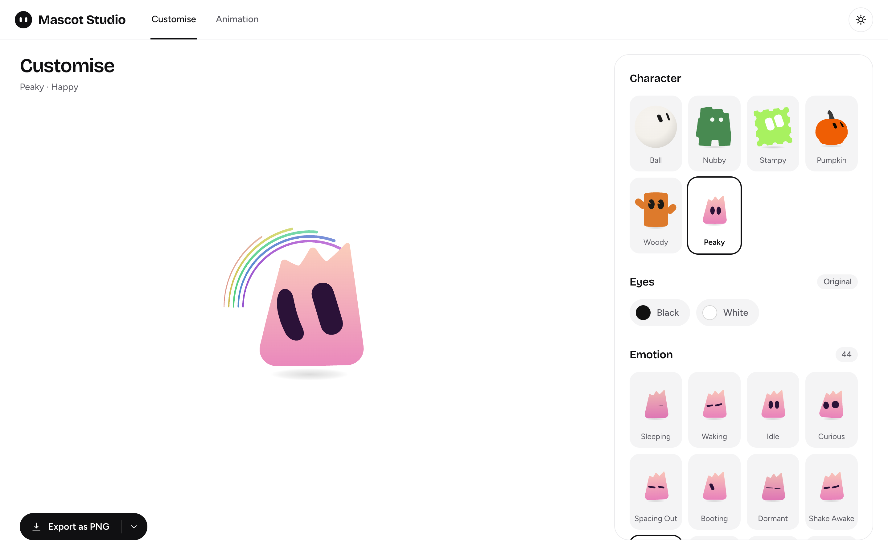

</div>

## Meet the mascots

<table align="center">
  <tr>
    <td align="center">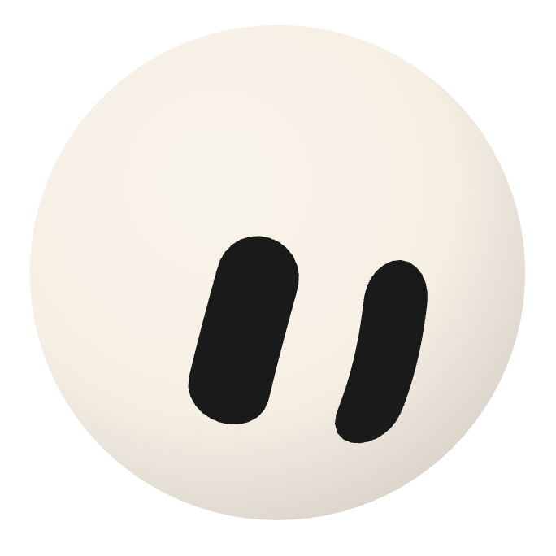<br><b>Ball</b><br><sub>44 emotions</sub></td>
    <td align="center">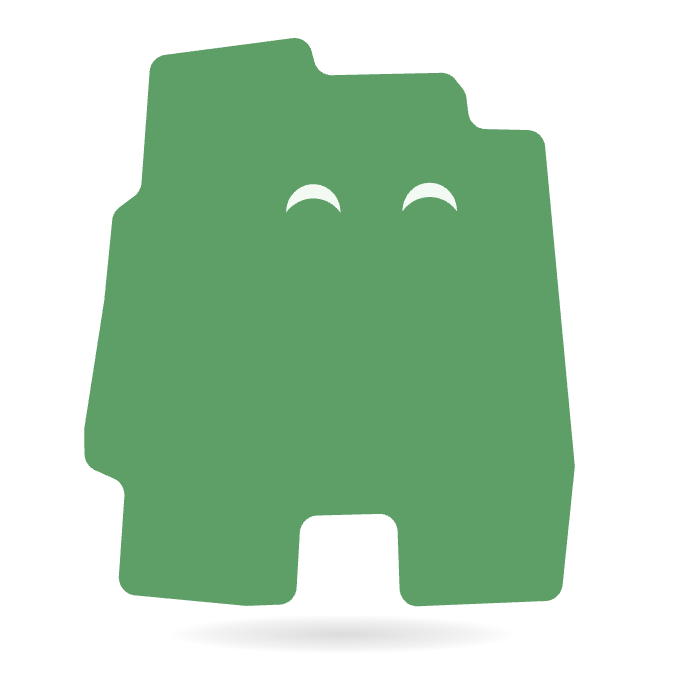<br><b>Nubby</b><br><sub>53 emotions</sub></td>
    <td align="center">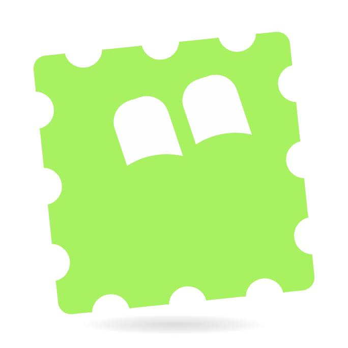<br><b>Stampy</b><br><sub>51 emotions</sub></td>
    <td align="center">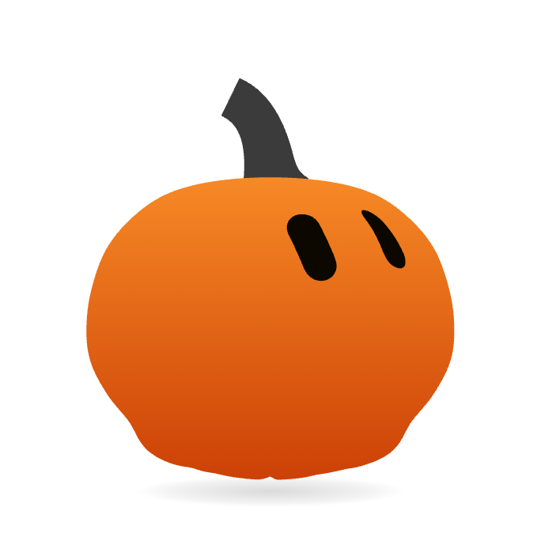<br><b>Pumpy</b><br><sub>56 emotions</sub></td>
    <td align="center">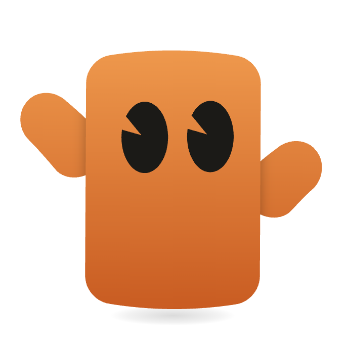<br><b>Woody</b><br><sub>44 emotions</sub></td>
    <td align="center">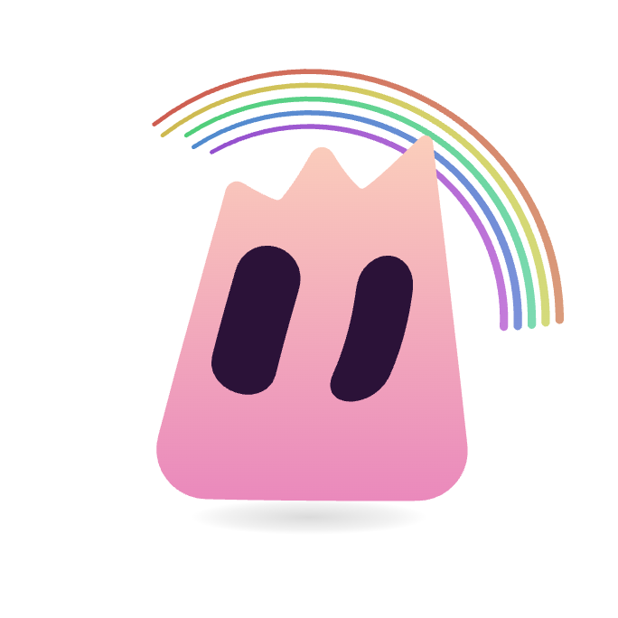<br><b>Peaky</b><br><sub>44 emotions</sub></td>
  </tr>
  <tr>
    <td align="center">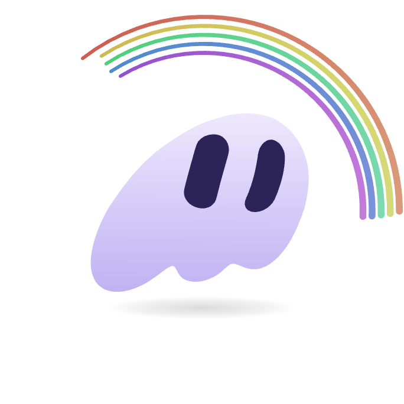<br><b>Ghosty</b><br><sub>44 emotions</sub></td>
    <td align="center">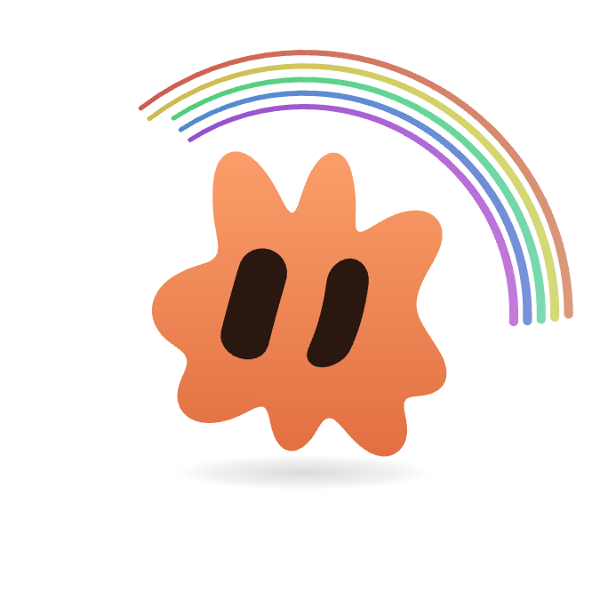<br><b>Bloom</b><br><sub>44 emotions</sub></td>
    <td align="center">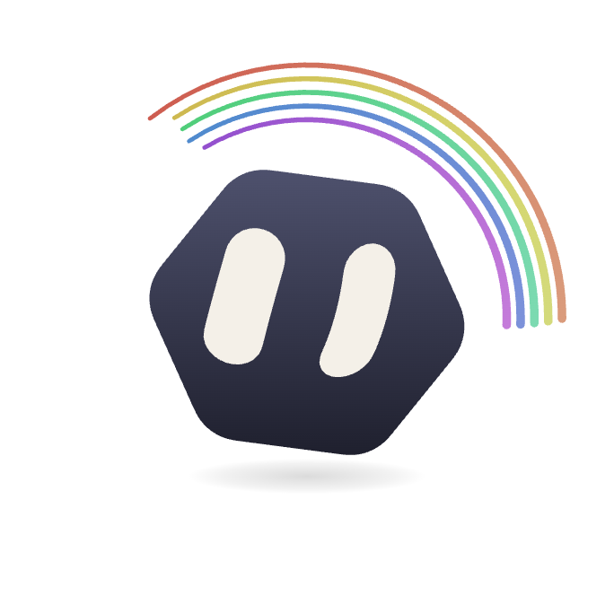<br><b>Hexo</b><br><sub>44 emotions</sub></td>
    <td align="center">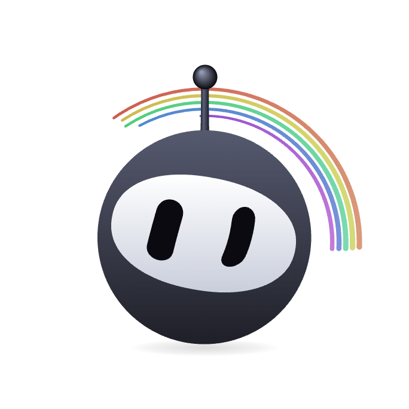<br><b>Ninjo</b><br><sub>44 emotions</sub></td>
    <td align="center">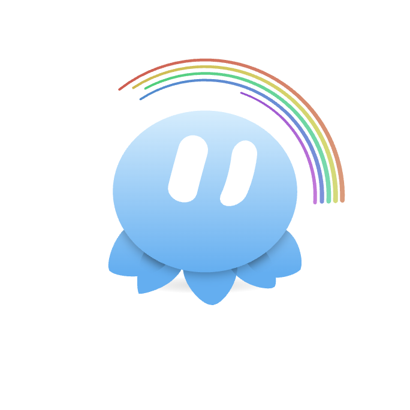<br><b>Jelo</b><br><sub>44 emotions</sub></td>
    <td align="center">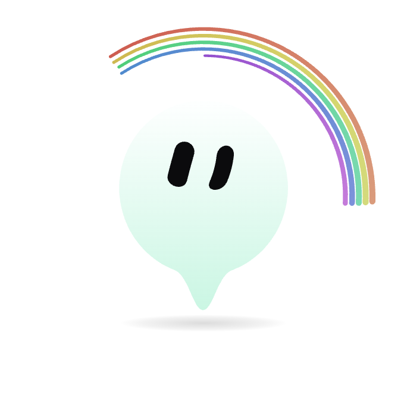<br><b>Drip</b><br><sub>44 emotions</sub></td>
  </tr>
  <tr>
    <td align="center">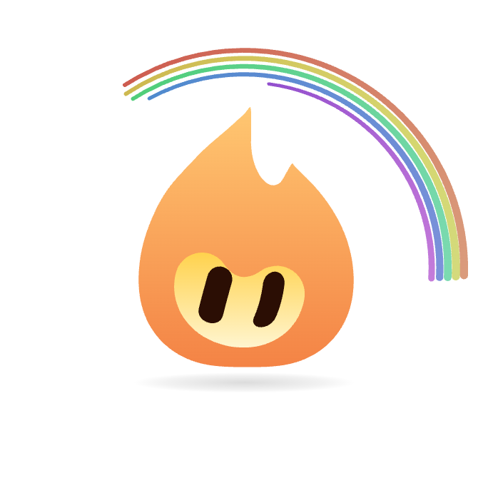<br><b>Flame</b><br><sub>44 emotions</sub></td>
  </tr>
</table>

| Mascot | Engine | What makes it special |
| --- | --- | --- |
| Ball | `src/engine/emotion-ball` | The Grok bot ball, with blob, wedge and gem shapes |
| Nubby | `src/engine/mood-mates` | A stair-stepped block on stubby legs, 9 video states, Peekaboo Pop and Marble Eyes click animations |
| Stampy | `src/engine/mood-mates` | A perforated postage stamp, 6 video states, corner peel and card flip click animations |
| Pumpy | `src/engine/mood-mates` | A carved pumpkin that turns like a 3D head, its eyes wrap around the curve, 8 click animations |
| Woody | `src/engine/mood-mates` | An orange wooden slab with raised arms and cut-notch eyes, a different arm pose for every emotion, Wave, Cheer and Timber click animations |
| Peaky | `src/engine/mood-mates` | A pink-to-peach mountain with a three-peak crown, built as a soft pillow-shaped 3D solid, Rumble, Survey and Wring click animations |
| Ghosty | `src/engine/mood-mates` | A white-and-lavender ghost leaning like a tilted teardrop, with a tail of three soft lobes, built as a smooth 3D solid |
| Bloom | `src/engine/mood-mates` | An orange flower with eight petals of different lengths, two tall ones leaning up, built as a puffy 3D solid |
| Hexo | `src/engine/mood-mates` | A glossy dark rounded hexagon with bright eyes, built as a chunky 3D solid |
| Ninjo | `src/engine/mood-mates` | A round black ninja-bot with a white visor, Grok-style capsule eyes and a shaded 3D antenna, built as a smooth 3D solid |
| Jelo | `src/engine/mood-mates` | A glossy blue jelly dome with two tall oval eyes and five leaf-shaped legs tucked behind it, each leg fitted to the reference image |
| Drip | `src/engine/mood-mates` | A pale mint bubble with two small oval eyes and a smooth drip tail, built as a round solid that stays slim from every side |
| Flame | `src/engine/mood-mates` | A tilted J-curve flame in glowing orange with a bright yellow face area that turns with its eyes, built as a 3D solid whose tip stays pointed from every side |

The emotion counts are what Mascot Studio shows for each character.

## Design your own mascot in the browser

<div align="center">

**No code, no account. Shape it, colour it, export it.**

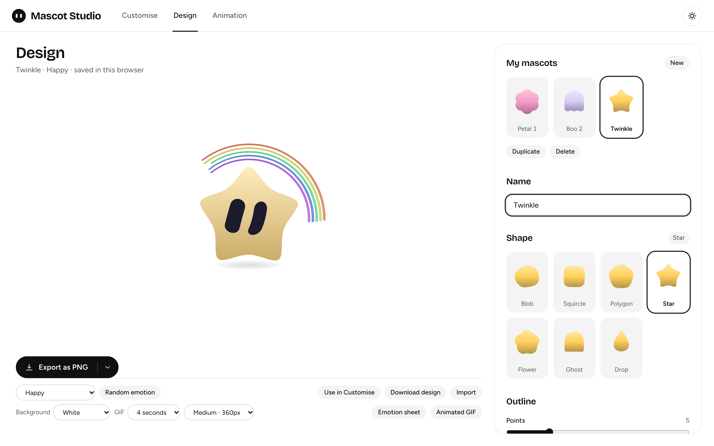

</div>

Open the **Design** tab (`http://localhost:5173/#design`) and pick a starting shape. Every slider updates the 3D preview live, and your mascot gets all 44 emotions the built-in characters have.

1. **Pick a template:** Blob, Squircle, Polygon, Star, Flower, Ghost or Drop.
2. **Sculpt it** with the controls below.
3. **Preview any emotion** from the dropdown, or press **Random emotion**.
4. **Export it** as a PNG, SVG, GIF, video, emotion sheet or embed code, or press **Use in Customise** to recolour it and build an animation timeline with it.

| Section | What you can change |
| --- | --- |
| Shape | The base template. Your colours and other settings carry over when you switch |
| Outline | Corners, points, petals or tail lobes; wobble, squareness, point or petal depth; roundness; width; height; tilt. Blob has a **Shuffle** button for a new random wobble |
| Body | Size, thickness and puffiness of the 3D body |
| Colour | Body colour (swatches or any colour), plus the top and bottom of the gradient. **Auto gradient** rebuilds them from the body colour |
| Eyes | Colour, left/right and up/down position, spacing, size, and tall or wide |

<div align="center">
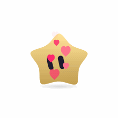
<br><sub>Exported straight from the Design tab: <b>Animated GIF</b>, Love Strike, 4 seconds.</sub>
</div>

**Saved in your browser.** Designs are stored in `localStorage` under `mascot-studio.designs.v1`, so they are still there after a reload with no login. Up to 40 designs fit, and each can be duplicated or deleted (Delete asks for a second click). Clearing site data or using a private window starts you fresh, so download the ones you want to keep.

**Share a design.** **Download design** saves a small `.mascot.json` file. **Import** loads one back as a new mascot and never overwrites an existing one.

> [!NOTE]
> Designed mascots live in the studio. To ship one in your own app through `pnpm build:lib`, turn it into a character file with the Claude Code prompt in the next section, or follow `characters/hexo` (the same outline, gradient and eye settings map onto `rimSpec` and `rimEyes`).

## Build your own mascot from one image

<div align="center">

**Bring one picture. Get a fully animated 3D mascot.**

Smooth edges, a real gradient, a body that turns in 3D and all 44 emotions, built by Claude from your image alone.

</div>

> [!TIP]
> This is how Ghosty, Bloom and Hexo were made. You need Claude Code, this repo and one image.

**1. Set up the repo**

```bash
pnpm install
pnpm dev
```

**2. Open the repo in Claude Code** and drag your image into the prompt box.

**3. Paste this prompt and send it**

```text
Build one new mascot for this repo (Mascot Studio: Vite + React + TypeScript) from the image I attached.
It must match the image's silhouette, colours and eye position exactly, look fully 3D with smooth edges and a gradient, and support every emotion the repo already has.

First read src/engine/mood-mates/characters/rim.ts and one finished example: characters/ghosty (traced outline) or characters/hexo (simple geometric shape). Copy their patterns and do not guess any API. Before coding, tell me in two lines what you see: shape, body colour, eye colour, eye positions.

1. Silhouette: trace it from the image pixels, never by eye. With Playwright (already installed, channel 'chrome'), draw the image on a canvas, mask the character (ignore background and alpha), take its centroid, and cast 240 rays at equal angles from +x going clockwise on screen (y down). Store each ray's farthest character pixel divided by the largest radius in characters/<id>/radii.ts. Re-trace and compare to prove it matches. Simple shapes (hexagon, rounded square) can use roundedOutline instead.
2. Smooth: radialRing(radii, 100), then smoothContour or the windowed smoothing in ghosty/bloom until there are no dips, wiggles or flat tips that the image does not have.
3. 3D: rimSpec({ ring, unit: 100, depth, puff, sigma, edge, tint, scale, center }). Start from depth 0.6-0.8, puff 2.2-2.4, sigma 30-40, scale 66-80 and center [120,124], so the body fills about 70% of the 240 view.
4. Gradient: tint { top: [lighter, 0.5], bottom: [deeper, 0.55] }. Same hue family, lighter and warmer on top, deeper and richer at the bottom, like the other characters.
5. Eyes: rimEyes anchored at the image's eye position, converted into the 240 view (offset from the centroid divided by the max radius, times scale). Start from ghosty's values. Eyes must stay inside the body at every turn angle.
6. Emotions: rimCharacter gives all 44 emotions (sleep, moods, AI states, effects) for free. Fill palette(...) with state colours in the same hue family (blush pink, angry red, off grey). If I attached an expression sheet, match those eye shapes too.
7. Register: add the import and characters.register(...) in src/engine/mood-mates/index.ts. The studio picks it up on its own.
8. Verify with scratch scripts in /tmp against pnpm dev, and delete them afterwards: a contact sheet of all emotions; the body turned from -70 to 70 degrees; recolouring with the studio swatches (Rose, Sky, Pink, Emerald) and Reset; eyes inside the outline; then pnpm typecheck && pnpm lint && pnpm build && pnpm build:lib. Show me the images and numbers. Do not say done without them.

Rules: no click animations unless I ask. Do not change existing characters or shared engine files; if one needs changing, stop and ask me. Match the existing code style. Add the character's card to this README and its screenshot to docs/screenshots/<id>.png, then commit it all as one commit.
```

**4. Open `http://localhost:5173/`.** Your character is in the picker, with every emotion ready.

<details>
<summary><b>Tips for a better result</b></summary>

- Use one character per image, front view, on a plain or transparent background, with both eyes visible.
- Want custom expressions? Attach a second image of the expressions you want and the prompt will match those eye shapes.
- Want click animations? Add "also build three click animations" to the prompt. Without it, the character gets the body animation only.
- Not happy with a detail? Say so in plain words, for example "smooth the dip on the left side" or "make the top lighter".

</details>

## Mascot Studio

A React app for trying every mascot before you wire one into your product.

- **Customise:** pick a character, an eye colour and any of its emotions, and recolour the body.
- **Design:** build your own mascot from a template with live 3D preview. It is saved in your browser and works everywhere in the studio. See [Design your own mascot in the browser](#design-your-own-mascot-in-the-browser).
- **Animation:** build a timeline of 2-second clips, play it back, and export the whole timeline as a GIF or video.
- **Export:** on every tab, download a PNG, SVG, GIF or MP4 video, copy the image or SVG code, or copy a one-paste embed code. See [Exports](#exports).
- **Themes:** light and dark.

<div align="center">
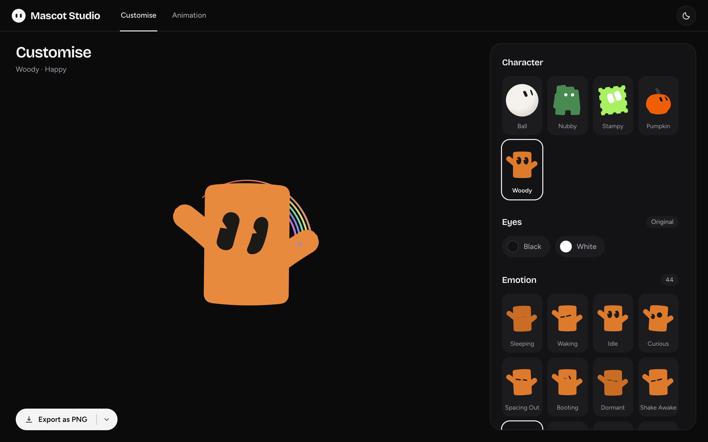
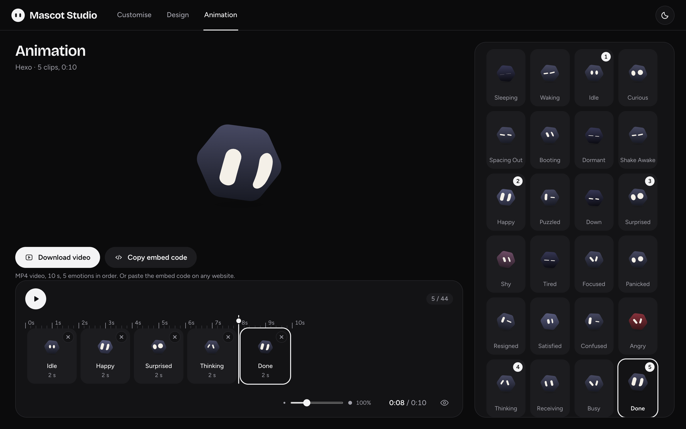
</div>

### Exports

Customise, Design and Animation all end in the same row: an export menu for images and GIFs, then **Download video** and **Copy embed code**.

| Button | What you get |
| --- | --- |
| **Export menu** | The main button exports a PNG (Customise and Design) or a GIF (Animation). The arrow beside it opens the rest: **Download PNG** (1024 × 1024, transparent), **Download SVG** (vector, sharp at any size), **Download GIF** (512 × 512, 25 fps, on the studio's light or dark background), **Transparent GIF**, **Copy image** and **Copy SVG code**. GIFs loop 4 seconds of the current emotion on Customise and Design, and play your whole timeline on Animation. |
| **Download video** | An MP4 (H.264, 512 × 512, 30 fps) that plays in any browser, phone, Slack, WhatsApp, PowerPoint or video player. Customise and Design record 4 seconds of the character, colours and emotion you have selected. Animation records your whole timeline, every clip in order, transitions and effects included. The background follows the studio theme. |
| **Copy embed code** | One snippet that puts the live mascot on any website, with the same character, colours and emotion. On the Animation tab it plays your timeline on a loop. You can switch emotions yourself with `bot.setEmotion('10')`. |
| **Emotion sheet** (Design) | One PNG with every emotion's pose, labelled with its name and ID. Pick a white, dark or transparent background first. |
| **Animated GIF** (Design) | A GIF with your own settings: 2, 4 or 6 seconds; 240, 360 or 480 px; white, dark or transparent background. |

```html
<div id="mascot-x7k2p" style="width:240px;height:240px"></div>
<script src="https://your-studio.example.com/mood-mates.js"></script>
<script>
  var bot = MoodMates.create(document.getElementById('mascot-x7k2p'), {
    character: 'pumpkin',
    color: '#E11D48'
  });
  bot.setEmotion('10');
</script>
```

An Animation timeline with several clips becomes `bot.startTour(['10', '30', '33'], 2000)` instead, which plays the clips in order, 2 seconds each, and repeats.

Each copy gets its own id, so you can paste several mascots on one page. The studio serves its own copy of the libraries at `/mood-mates.js` and `/emotion-ball.js`, so the snippet works as soon as the studio is deployed. For production, copy those files next to your site and change the `src`: otherwise your mascot stops if the studio goes offline. Mascots from the Design tab work the same way: the snippet carries the design as a few hundred characters of JSON.

**In React or Next.js**, do not paste the snippet into JSX (scripts inside JSX never run). Load the library once and create the mascot in an effect. Call `destroy()` in the cleanup, otherwise `StrictMode` shows two mascots:

```jsx
import { useEffect, useRef } from 'react';

const LIBRARY = 'https://your-studio.example.com/mood-mates.js';
let loading;

function loadLibrary() {
  loading ??= new Promise((resolve, reject) => {
    const script = document.createElement('script');
    script.src = LIBRARY;
    script.onload = resolve;
    script.onerror = reject;
    document.head.appendChild(script);
  });
  return loading;
}

export function Mascot({ character = 'pumpkin', color, emotion = '10' }) {
  const host = useRef(null);

  useEffect(() => {
    let bot;
    let stopped = false;
    loadLibrary().then(() => {
      if (stopped) return;
      bot = window.MoodMates.create(host.current, { character, color });
      bot.setEmotion(emotion);
    });
    return () => {
      stopped = true;
      bot?.destroy();
    };
  }, [character, color, emotion]);

  return <div ref={host} style={{ width: 240, height: 240 }} />;
}
```

A site with a strict Content Security Policy must allow the script's address and an inline `style` on the container, or give the container its size from a CSS class instead.

Videos and GIFs are recorded off-screen on a fixed clock, so they look the same however busy the page is, and they keep your recolour and eye colour. Recording video needs a browser that can encode video with WebCodecs (tested in Chrome). If yours cannot, the studio says so and the GIF and embed code still work. For a transparent background, use the PNG, SVG, Transparent GIF or embed code. Transparent GIFs only support fully clear or fully solid pixels, so their edges are a little jagged. GIFs are also larger than videos, about 1.4 MB for a 4-second loop. **Download design** on the Design tab saves a small `.mascot.json` file you can import again.


## Quick start

```bash
pnpm install
pnpm dev
```

Open `http://localhost:5173/`. You need Node `^20.19.0` or `>=22.12.0`.

## Use in your app

Build the script-tag bundles with `pnpm build:lib`, then:

```html
<script src="dist-lib/mood-mates.iife.js"></script>
<div id="bot" style="width:200px;height:200px"></div>
<script>
  const bot = MoodMates.create(document.getElementById('bot'), { character: 'nubby', emotion: '02', idle: true });
  bot.handleAIMessage('{"emotionId":"30","tips":"thinking"}');
</script>
```

- `MoodMates.create` takes `character`: `nubby`, `stampy`, `pumpkin`, `woody`, `peak`, `ghosty`, `bloom`, `hexo`, `ninjo`, `jelo`, `drip` or `flame`.
- For the ball, load `dist-lib/emotion-ball.iife.js` and call `EmotionBall.create(el, { shape: 'blob' })`.
- In React, mount any mascot through `src/app/components/Mascot.tsx`.
- Unknown IDs and bad JSON fall back to idle (`02`) and emit an `error` event.
- `tips` is surfaced through the `tips` event.
- Every character shares the same emotion IDs, so one mapping works for all of them. Open the studio to browse them.

## Project layout

```
src/engine/emotion-ball/       Grok bot ball engine
src/engine/mood-mates/         engine for Nubby, Stampy, Pumpy, Woody, Peaky, Ghosty, Bloom, Hexo, Ninjo, Jelo, Drip and Flame
  characters/<name>/           one folder per character: shape, eyes, emotions, clips
  characters/rim.ts            shared recipe for outline-based 3D characters (Peaky, Ghosty, Bloom, Hexo, Ninjo)
  design.ts                    compiles a Design-tab mascot into a character; also used by the embed library
  solid/                       shared 3D solid renderer (slabs, limbs, inflated outlines)
src/engine/shared/             code shared by both engines
src/app/                       Mascot Studio (React): App, components, export, theme
  designer/                    Design tab: browser storage for saved designs
  recorder.ts                  hidden engine on a fixed clock, shared by the video, GIF and emotion sheet exports
  videoExport.ts               off-screen MP4 recorder
  mediaExport.ts               GIF and emotion sheet renderer
  exportImage.ts               PNG and SVG export and copy
  embed.ts                     builds the copy-paste embed code
scripts/publish-embed.mjs      copies the two libraries into dist so the studio serves them
src/styles/app.css             the studio's styles, light and dark tokens
docs/screenshots/              images used in this README
```
